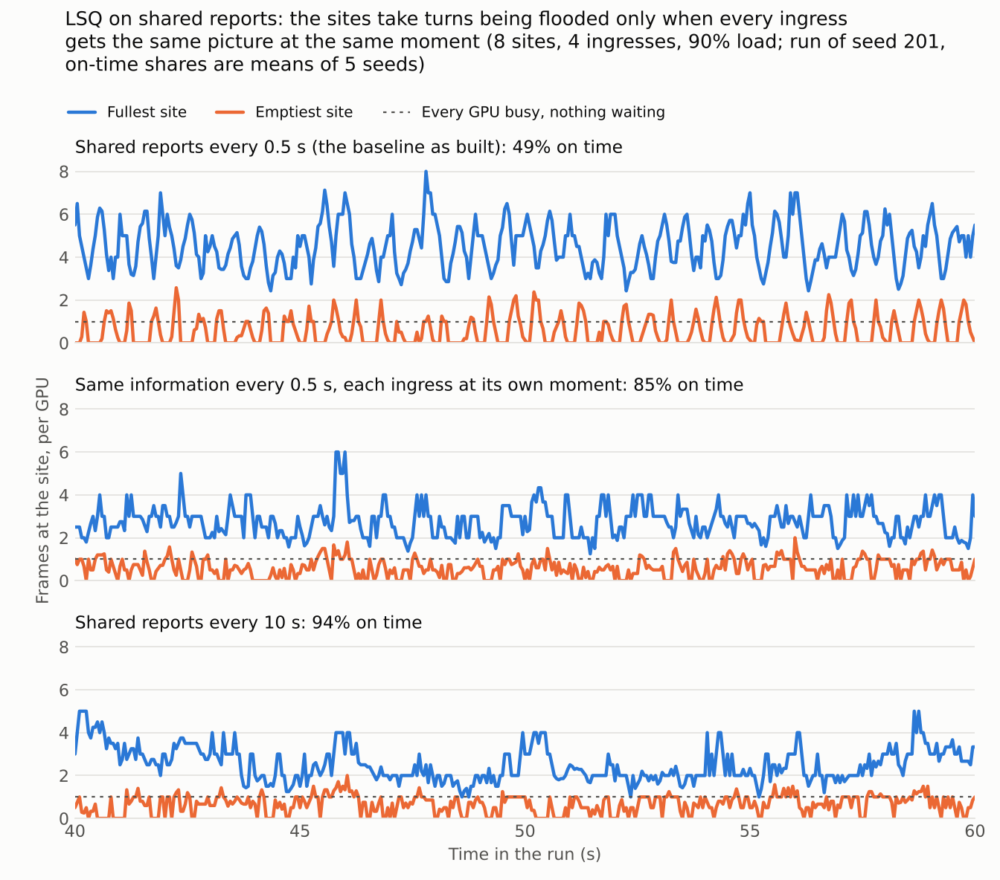

# Phase 3: the baselines

- **Project:** Packet Patrol, CMPS 342. **Date:** 15 Nov 2026. **Status:** done.
- **Questions (Prof. Maurice, 11 Nov 2026):** are LSQ, Prequal and the "oracle" what we call them? Is the LSQ collapse real or produced by our adaptation?
- **Short answers:**
  - **The LSQ collapse is produced by the shared reports, not by LSQ.** Give every ingress the same information at its own moment instead of the same moment, and LSQ goes from 49% to 85% on time. Random tie-breaking changes nothing.
  - Every baseline now has a label. None of D to I is a reproduction of the original system.
  - Prequal keeps its asynchronous probing. What we changed is the probe rate (about 100 times lower).
  - The "oracle" is renamed "fresh-state greedy selection".
  - The new deadline-aware static split, once tuned, is the capacity split on our network. It gives the same results as round-robin with admission.
- Every number in sections 3, 6 and 7 is computed from the result files in `feedback/phase3/` by `feedback/phase3/build_baselines_note.py`. The other figures quote the saved v6 study and name their file.

## 1. Every baseline: source, original mechanism, what we built, label

| | Baseline (run name) | Reference | Original mechanism | What we built | Main differences | Label |
|---|---|---|---|---|---|---|
| A | Nearest site (`nearest`) | the network-only steering that CATS improves on: C. Li (Ed.), Z. Du, M. Boucadair (Ed.), L. M. Contreras, J. Drake, "A Framework for Computing-Aware Traffic Steering (CATS)", RFC 10053, Oct 2026, introduction ✓ | lowest network cost | lowest configured round trip | none | Exact |
| B | Capacity round-robin (`wrr`) | nginx smooth weighted round-robin (2012) | each pick adds every weight, takes the largest, subtracts the total | the same; weights = configured GPUs | none | Exact |
| C | Dynamic round-robin (`wrr_speed`) | the DWRR family (no single source) | weights follow measured server speed | smooth round-robin on the GPUs each site is measured to have | the measurement is our own speed meter | Ours |
| D | Weighted power of two (`wpow2_stale`) | M. Mitzenmacher, "The power of two choices in randomized load balancing", IEEE TPDS 12(10), 2001 † | sample two servers, join the shorter queue | sample two sites in proportion to capacity, take the lower last-reported load per GPU | capacity-weighted sampling, load per GPU, shared periodic reports | Adapted |
| E | Dahlin, Basic LI (`dahlin_li`) | M. Dahlin, "Interpreting stale load information", IEEE TPDS 11(10), 2000, section 4 † | the arrivals expected in a phase fill the least-loaded servers to a common level; choices are randomised by that fill | the same (Eq. 4) | loads per GPU for unequal sites; arrival rate from the report counters; phase = W + mean report age | Adapted |
| F | LSQ (`lsq`) | S. Vargaftik, I. Keslassy, A. Orda, "LSQ: Load Balancing in Large-Scale Heterogeneous Systems With Multiple Dispatchers", IEEE/ACM Trans. Netw. 28(3), 1186–1198, 2020 ✓ | each dispatcher keeps its own view of the queues, joins the shortest and increments it; each view is refreshed on its own (random samples, or a server updating one random dispatcher) | view = last report + own frames sent since; smallest count per GPU; ties to the larger site | **the refresh is the shared report: same picture, same moment, every ingress**; no randomised refresh | Adapted ("LSQ on shared reports") |
| F2 | LSQ-Sample (`lsq_sample`) | the same paper, section V-A | sample d = 2 queues at every arrival | the same view, refreshed by the ingress's own random samples | the sampling rate follows the byte budget: about 8.5 samples per second per ingress at the 0.5 s budget, against 2 per arrival (about 144 per second) | Adapted |
| G | Prequal (`prequal_hcl`) | B. Wydrowski, R. Kleinberg, S. Rumble, A. Archer, "Load is not what you should balance: Introducing Prequal", NSDI 2024, section 4 † | asynchronous probes to random servers; a pool of answers; hot-cold rule on requests in flight and latency | the same probing, pool, reuse and removal rules, and the hot-cold rule | **probe rate set by the byte budget: about 0.03 probes per frame, against 3 to 5**; pool of 4 (16); requests in flight per GPU; latency includes the round trip | Adapted |
| H | Liyanage et al. (`liyanage26`) | M. Liyanage, A. Abdullah, E. Zhantileuov, R. Schuster, "Risk-Aware and Stable Edge Server Selection Under Network Latency SLOs", arXiv:2604.21483, 23 Apr 2026; accepted at IWCMC 2026 ✓ | per server, mean and deviation of observed latency; Normal and Cantelli risk; percentile score; switch only after N consecutive wins | the same formulas and hysteresis, per client | a client = one camera, several per ingress; observations = own frames plus budget probes; threshold = the frame deadline; window of 40 | Adapted |
| I | CATS-draft load sharing (`cats_lb`) | H. Fu, D. Huang, L. Ma, W. Duan, B. Tan (ZTE), "Flow-Level Load Balancing of Computing-Aware Traffic Steering (CATS)", draft-fu-cats-flow-lb-03, Feb 2026. An individual Internet-Draft, work in progress ✓ | SLA-feasible alternatives with load-sharing weights; table rebuilt when metrics cross a threshold, with hysteresis; expansion into equal entries; hash of the flow id | the same structure | metric, SLA filter, weight formula, threshold and hysteresis values are ours (the draft leaves them open); each frame is its own flow | Our instantiation of a draft |
| J | Expected delay + drop (`expected_delay_drop`) | ours (the v1 belief) | | lowest expected response time; drop if even that is over the deadline | | Ours |
| L | Fresh-state greedy selection (`oracle`) | reference | | reads the true state at the moment of the decision; lowest late chance for that frame | not an upper bound (section 5) | Reference |
| | Round-robin + admission (`wrr+adm61`) | ours | | capacity round-robin behind the common rejection wrapper, with v6.1's estimate | | Ours (matched admission) |
| | Deadline-aware static split (`static_deadline+adm61`) | ours, new (section 6) | | shares fixed in advance from capacities, deadline and round trips; the same wrapper | | Ours |

- ✓ = checked against its source page on 15 Nov 2026. † = as recorded in `BASELINES.md` or cited from memory; check volume and pages before the paper.
- Parameters, adaptations in full and the verification tests of each baseline are in `BASELINES.md`.

## 2. LSQ: which variant we built

- **Kept:** the local view per dispatcher, the increment for each own frame, and "join the shortest local queue".
- **Not kept:** LSQ's own update mechanism. In the paper each dispatcher refreshes its view independently, so two dispatchers rarely hold the same picture. Our `lsq` is refreshed by the CATS reports, which reach every ingress with the same numbers at the same moment.
- **Randomised choices:** none, except between exactly tied sites of the same size.
- **One more property of the view:** it adds the ingress's own frames but never removes finished ones. A site's count only comes down when it is refreshed.

## 3. The LSQ diagnostic

- Where the collapse was reported: the 8-site network, 4 ingresses, 90% load, seeds 201 to 205. Each variant changes one thing.
- "Busiest site's load in a half second" = in each half second, the arrivals at the most loaded site divided by what it can serve; averaged over the run. 1 means no site is ever flooded.

| Variant | What changes | On time, reports every 0.5 s | On time, every 10 s | Busiest site's load in a half second (0.5 s) |
|---|---|---|---|---|
| LSQ as built (`lsq`) | shared reports, every ingress at the same moment; smallest count, ties to the larger site | 49.3% | 93.8% | 1.75 × capacity |
| Random ties (`lsq_randtie`) | ties broken at random | 48.8% | 93.6% | 1.84 × capacity |
| Control: polls, same moment (`lsq_poll_sync`) | polls instead of reports, same information and age, every ingress at the same moment | 48.8% | 94.0% | 1.70 × capacity |
| Own moment per ingress (`lsq_poll_phase`) | the same polls, each ingress at its own random moment in the interval | 85.2% | 94.9% | 1.28 × capacity |
| Own moment per ingress and site (`lsq_poll_site`) | the same polls, each (ingress, site) pair at its own moment | 72.0% | 40.7% | 1.38 × capacity |
| LSQ-Sample at the byte budget (`lsq_sample`) | the paper's own random samples, at the byte budget of each report interval | 62.9% | 29.6% | 1.59 × capacity |
| Capacity round-robin (`wrr`) | no telemetry (for reference) | 94.6% | 94.6% | 1.01 × capacity |
| Round-robin, random start (`wrr_phase`) | each ingress starts its cycle at a random point | 95.1% | 95.1% | 1.01 × capacity |

**What it shows**
- **The control reproduces the collapse** (48.8% against 49.3%). So polls are a fair stand-in for reports.
- **Moving only the moment removes most of it.** Same information, same age, but each ingress at its own moment: 49.3% → 85.2%. The busiest site's half-second load falls from 1.75 to 1.28 times its capacity.
- **Random tie-breaking does nothing** (48.8%).
- **The round-robin phase does nothing either** (94.6% and 95.1%).
- It is not fully gone: 85.2% is still below round-robin, and it ranges from 58% to 94% over the five seeds (the moments are drawn at random in each run).

**The mechanism** (read from the code; it agrees with every row of the table)
- With a shared report every 0.5 s, all four ingresses see the same emptiest site and send to it for the same half second. Each counts only its own frames, so the site receives several times what any one of them thinks. The next report shows it full and they all move on.
- With a shared report every 10 s, the ingress's own counts soon outweigh the snapshot. It then fills the sites in proportion to their size, which is capacity round-robin (93.8% against 94.6%).
- A site refreshed alone looks emptier than the others, whose counts have only grown. This is why refreshing each site at its own moment is bad when refreshes are rare (40.7% at 10 s), and why LSQ-Sample at our byte budget is poor (62.9% and 29.6%): it gets about 8.5 and 0.4 samples per second per ingress, where the paper assumes two per arrival.

**Conclusion**
- The fall from 93.9% to 49.0% in the v6 study (`RESULTS.md`; 93.8% and 49.3% on these five seeds) is a property of **shared, synchronised reports with a deterministic minimum**. It is not a property of LSQ as published.
- It stays a relevant result for CATS, where every ingress does receive the same metric updates. But the paper must present it as "LSQ adapted to shared reports", next to this diagnostic.
- Limits of the diagnostic: polls cost about twice the bytes of reports, so the variants are mechanism checks and not budget-matched rules.

## 4. Prequal

- The feedback asks whether Prequal's asynchronous probing was replaced by the shared reports. It was not: `prequal_hcl` probes random sites asynchronously, keeps a pool, and applies the hot-cold rule, as in the paper.
- What differs is the rate. At the common byte budget it sends about 2 probes per second per ingress, about 0.03 per frame, where Prequal uses 3 to 5 per query.
- Existing evidence (`study_results/tables/diag_prequal_budget.csv`): at the medium budget each probe is planned for about 395 uses, and 18% of decisions fall back to a random choice. At the low budget all do.
- So the result labelled Prequal is "Prequal at the report byte budget". `prequal_native` (3 probes per query, about 100 times the budget) is the run in its intended regime, and the paper should show both.

## 5. The "oracle" is renamed

- New name everywhere: **fresh-state greedy selection**. Labels are changed in `catsim/study.py`, `catsim/v5.py`, `catsim/v6.py`, `catsim/v6_analysis.py`, `catsim/plots.py`, `catsim/config.py` and `BASELINES.md`. The run name `oracle` stays, so saved results keep their names.
- Why: it reads the true state at the moment of the decision and sends each frame where its own late chance is lowest. It does not see frames in flight, it does not plan ahead and it cannot drop. It is not an upper bound.
- The saved v6 report (`RESULTS.md`) keeps the old word; it describes the frozen study. Its column "oracle gap" (`catsim/study_writeup.py`) becomes "gap to fresh-state greedy" in the paper.

## 6. The new baseline: a deadline-aware static split

**What it is** (`catsim/baselines.py`, `StaticDeadline`)
- No telemetry. The shares are computed once, from what an operator knows in advance: the GPUs of each site, the service rate, the deadline and the round trip from this ingress to each site.
- For a design load (a share of total capacity), the shares minimise the long-run number of late frames: late share of a site = Σ over queue lengths of (long-run chance of that queue) × (chance of missing the deadline behind it). The best split of 100 pieces is found exactly.
- Frames follow the shares by smooth weighted round-robin. Admission comes from the common wrapper, with v6.1's estimate (`static_deadline+adm61`).
- It reacts to nothing: failures, slowdowns, bursts and wrong configured sizes are not seen.

**Tuning** (the design load; pilot seeds 101 to 105, Beirut, 16 scenarios; deadline success in %)

| Scenario | Static 70% + admission | Static 85% + admission | Static 95% + admission | Round-robin + admission | Ours v6.1 |
|---|---|---|---|---|---|
| Main scenario (85% load) | 91.9 | 95.4 | 95.6 | 95.6 | 95.6 |
| Load 95% | 35.3 | 72.8 | 74.4 | 74.4 | 83.6 |
| Load 130% | 45.8 | 58.3 | 60.6 | 60.6 | 63.2 |
| Burst to 140% for 20 s | 72.2 | 74.2 | 74.3 | 74.3 | 82.4 |
| Server failure and return | 85.8 | 85.4 | 85.4 | 85.4 | 89.9 |
| Shared GPUs | 68.8 | 72.3 | 72.1 | 72.1 | 79.6 |
| Wrong weights | 39.1 | 56.6 | 68.8 | 68.8 | 86.3 |
| Reports every 0.2 s | 92.8 | 95.5 | 95.7 | 95.7 | 95.9 |
| Reports every 30 s | 92.6 | 95.7 | 95.8 | 95.8 | 95.8 |
| 2 ingresses | 92.1 | 95.5 | 95.7 | 95.7 | 95.7 |
| Deadline 200 ms | 69.1 | 71.6 | 71.8 | 71.8 | 71.8 |
| Load 115% | 51.9 | 65.7 | 66.7 | 66.7 | 70.6 |
| Load 95%, Ingress B doubles for 50 s | 54.7 | 62.7 | 63.4 | 63.4 | 75.0 |
| Load 125%, sites report at different moments | 51.3 | 63.7 | 64.7 | 64.7 | 66.4 |
| Load 120%, reports every 1 s | 49.9 | 63.1 | 65.2 | 65.2 | 69.3 |
| Load 120%, 30% of reports lost | 49.7 | 62.8 | 64.1 | 64.1 | 67.9 |
| **Mean of the 16** | **65.2** | **74.4** | **75.9** | **75.9** | **80.6** |

- **Chosen: design load 95%** (the highest mean).
- **At 95% its shares are the capacity shares** (14% / 29% / 57% on Beirut). It then sends exactly like capacity round-robin: the two columns are identical in 16 of 16 scenarios.
- Lower design loads move traffic from the small site to the large one, which is worse once the load is high.
- So on this network deadline-awareness adds nothing to a static split. A likely reason: the farthest site's round trip is only 20% of the deadline.
- The baseline is kept for networks where that is not so. The new network of the evaluation set has its largest site at 40% of the deadline (`FREEZE_v6.1.md`).
- Pilot preview only, not a result: v6.1 is ahead of round-robin + admission in 11 of the 16 scenarios, behind in 0, and within its interval in 5. The evaluation uses new seeds.

## 7. Same footing in the decisive comparison

| | Ours v6.1 | Round-robin + admission | Static split + admission |
|---|---|---|---|
| Telemetry received | reports + arrivals counter + drop counter | the same | the same |
| Bytes per second per ingress, main scenario | 39.4 | 39.4 | 39.4 |
| Bytes per second per ingress, load 130% | 40.9 | 40.9 | 40.9 |
| Offered-traffic estimate | drop counter (Phase 1) | the same | the same |
| May drop a frame | at the ingress, per frame | the same | the same |
| Admission rule | from 90% of measured capacity: drop what does not fit under the 95% site limits, and any frame that would cost more than one miss at every site | keep admitted traffic at 95% of configured capacity | the same as round-robin |
| Routing uses the reports | yes | no | no |
| Uses the answers to its own frames | yes (calibration) | no | no |
| Dispatch | smooth weighted round-robin on planned shares | smooth weighted round-robin on capacity | smooth weighted round-robin on static shares |

- The three have the same telemetry, the same bytes and the same chance to drop. They differ in the admission rule and in what routing uses.
- "Matched admission" therefore means: same information and same opportunity, not the same decision rule and not the same rejection rate. Batch A reports the rejected share of each next to its success.

## 8. Wording for the paper

- "LSQ" → "LSQ adapted to shared periodic reports"; do not write that LSQ collapses.
- "Prequal" → "Prequal at the report byte budget", with the native-rate run beside it.
- "Oracle" → "fresh-state greedy selection"; no claim of closeness to an optimum.
- "CATS-draft rule" → "our instantiation of draft-fu-cats-flow-lb-03, an individual Internet-Draft".
- State for D to I that they are adapted, and to what.

## Files

| File | What it is |
|---|---|
| `feedback/baselines.md` | this note |
| `BASELINES.md` | parameters, adaptations and tests of every baseline (updated for v6.1) |
| `feedback/phase3/lsq_variants.py` | the diagnostic variants of LSQ (not rules of the study) |
| `feedback/phase3/run_phase3.py` | `lsq` (80 runs), `static` (560 runs) |
| `feedback/phase3/lsq.csv`, `lsq_traj.npz`, `static.csv` | every run behind the tables and the figure |
| `feedback/phase3/plot_lsq.py`, `lsq_queues.png` | the figure |
